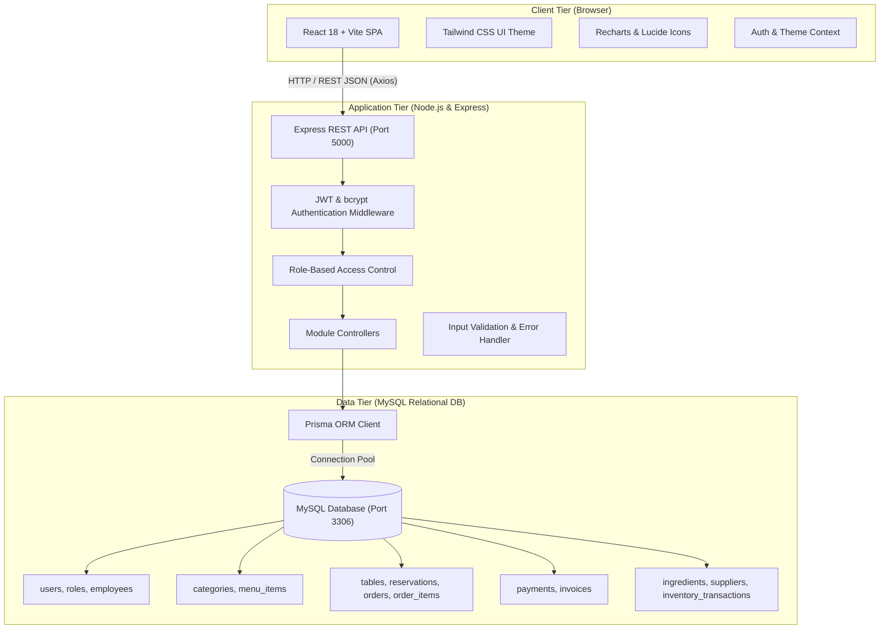
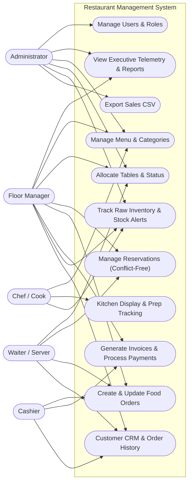
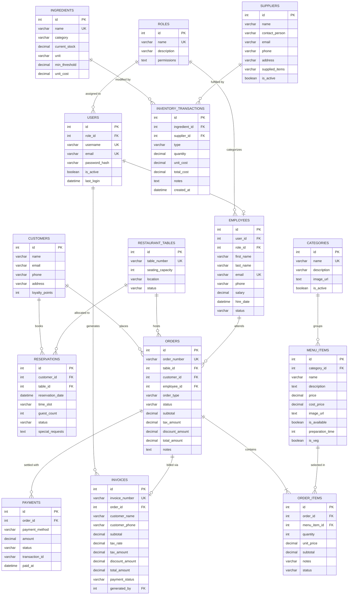
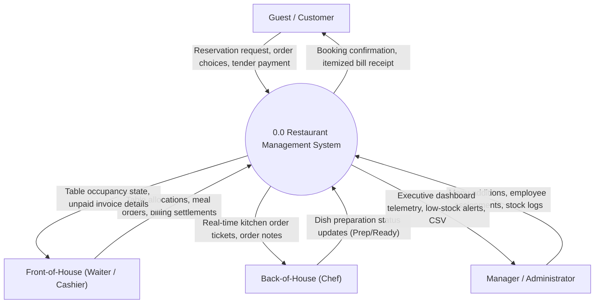
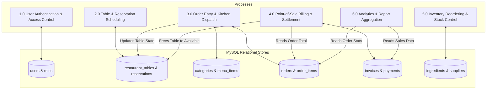

# System Design Diagrams

This document provides formal architectural and behavioral diagrams modeled with standard Mermaid specification for the **Restaurant Management System**.

---

## 1. System Architecture Diagram
The architecture is structured across three decoupled tiers: Presentation Layer, Application Layer, and Database Layer.

---

## 2. Use Case Diagram
Illustrates primary user actors (Admin, Manager, Chef, Waiter, Cashier) interacting with core system capabilities.

---

## 3. Entity-Relationship (ER) Diagram
A complete, normalized relational data model depicting all 15 MySQL tables with primary keys, foreign keys, and relationships.

---

## 4. Data Flow Diagrams (DFD)

### 4.1 Level 0 Context Diagram
Depicts the high-level boundaries between external actors and the restaurant management core process.

### 4.2 Level 1 Detailed DFD
Details the internal data transformations across distinct subsystem processes and data stores.

